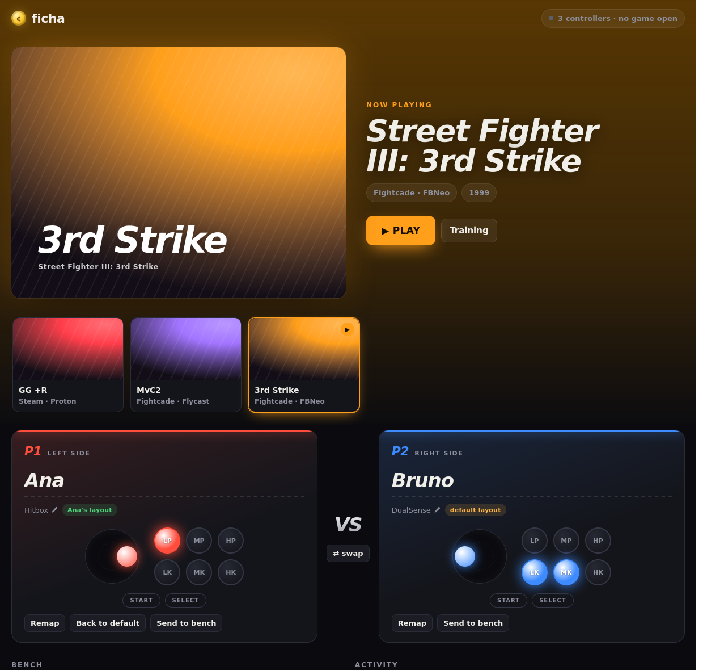

# ficha

**Plug-and-play controllers for local fighting game sessions.** Whoever shows up plugs in their controller and plays: P1/P2 are assigned automatically, everyone keeps their own button layout, and nobody has to dig through emulator input menus.

[Leia em português](README.pt-BR.md)



## Why

Emulators and PC games usually identify controllers **by index** (joystick 0, 1, 2…), and that index changes with the order people plug in. At a local session that means re-binding inputs every time someone swaps controllers.

ficha sits in the middle. It reads the physical controllers and always outputs through the **same virtual devices**: a virtual keyboard with fixed keys, or two virtual gamepads, "ficha P1" and "ficha P2". The game's config is set once and never changes. ficha decides who is P1 and who is P2.

## Features

- **Automatic P1/P2:** the first controller plugged in is P1, the next is P2, and the rest wait on the bench and join with START.
- **On the controller itself:** a quick START+SELECT swaps sides; holding START+SELECT for 2 s remaps the buttons.
- **Sensible default layout:** DualShock 4/DualSense, PS4/PS5 arcade sticks, Xbox pads and Raspberry Pi Pico boxes (GP2040-CE in XInput mode) are laid out by **physical position**, punches on top and kicks on the bottom. Unknown controllers (DInput boards, generic encoders) get an 8-press mapping wizard.
- **Per-player profiles, per game:** type your name in the panel and your layout follows you to any controller. Layouts are stored by physical position, so a layout made on an Xbox pad works on a DualSense.
- **Remembers each controller:** DS4/DualSense by MAC address, USB controllers by serial number, otherwise by model. Controllers can be renamed.
- **Web panel:** live button lights, a game shelf, PLAY / close game, works on a phone with `--lan`. Portuguese and English.
- **Games are TOML files:** add a game without touching code (see [docs/adding-a-game.md](docs/adding-a-game.md)).
- **Zero dependencies on Linux:** Python standard library only.

## Supported games and backends

| Backend | How ficha talks to the game | Built-in games |
|---|---|---|
| `fbneo-fightcade` | FBNeo (Fightcade) + virtual keyboard; ficha points the game's `.ini` at fixed keys | Street Fighter III: 3rd Strike |
| `flycast-fightcade` | Flycast (Fightcade) + virtual gamepads; other controllers are hidden from it | Marvel vs. Capcom 2 (Dreamcast) |
| `steam` | Steam/Proton + virtual gamepads; needs `ficha steam setup <game>` once | Guilty Gear XX Accent Core Plus R |
| `gamepad` | **any** game or emulator that reads gamepads (SDL, XInput, evdev), e.g. RetroArch | your own TOML |
| `keyboard` | **any** game configurable by keyboard | your own TOML |

ficha **does not include or download games or ROMs.** Use your own legally obtained copies.

## Install

**Easiest:** grab a file from the [latest release](https://github.com/vagnertxr/ficha/releases/latest):
- **Linux:** `ficha.pyz`, a single file with no dependencies. Run it with `python3 ficha.pyz`.
- **Windows (experimental):** `ficha-windows-x64.exe`.

### Linux (tested on Arch, GNOME/Wayland)

```bash
pipx install git+https://github.com/vagnertxr/ficha
```

ficha needs to create virtual devices through `/dev/uinput`. Many distros already allow this for the logged-in user (for example via the `steam-devices` package). If ficha says it has no access, install the udev rule:

```bash
sudo cp contrib/60-ficha.rules /etc/udev/rules.d/ && sudo udevadm control --reload && sudo udevadm trigger
```

Details in [docs/setup.md](docs/setup.md).

### Windows (experimental, untested)

The Windows platform is written but **has not been tested on a real Windows PC yet**. It needs Python 3.11+, the [ViGEmBus](https://github.com/nefarius/ViGEmBus) driver and, to hide physical controllers from games, [HidHide](https://github.com/nefarius/HidHide):

```bash
pip install "ficha[windows] @ git+https://github.com/vagnertxr/ficha"
```

Reports and fixes from Windows users are very welcome.

## Usage

```bash
ficha                   # start the hub and open the panel at http://localhost:7373
ficha play sfiii3nr1    # same, and launch the game
ficha games             # list games and whether they are installed
ficha steam setup ggxxacpr --proton proton_9   # prepare a Steam game (shows the changes, asks first)
ficha --lan             # also serve the panel on the local network (phone)
ficha --lang en         # force English (default: system language)
```

Every command also has a Portuguese name (`jogar`, `jogos`, `steam configurar`…).

## Documentation

- [Setup and permissions](docs/setup.md)
- [Adding a game](docs/adding-a-game.md)
- [Controllers and driver quirks](docs/controllers.md)
- [How it works](docs/architecture.md)
- [Troubleshooting](docs/troubleshooting.md)

## Status

ficha was built for, and tested at, real local sessions on Linux:
- **Fightcade:** 3rd Strike (FBNeo) and MvC2 (Flycast), in the Fightcade flatpak;
- **Steam:** Guilty Gear XX AC+R, with Proton 9, in the Steam flatpak;
- **controllers:** DualSense, a Brook PS4/PS5 board and an Xbox-protocol box.

Native (non-flatpak) Fightcade/Steam installs and Windows are implemented but not tested yet.

## License

[MIT](LICENSE).
