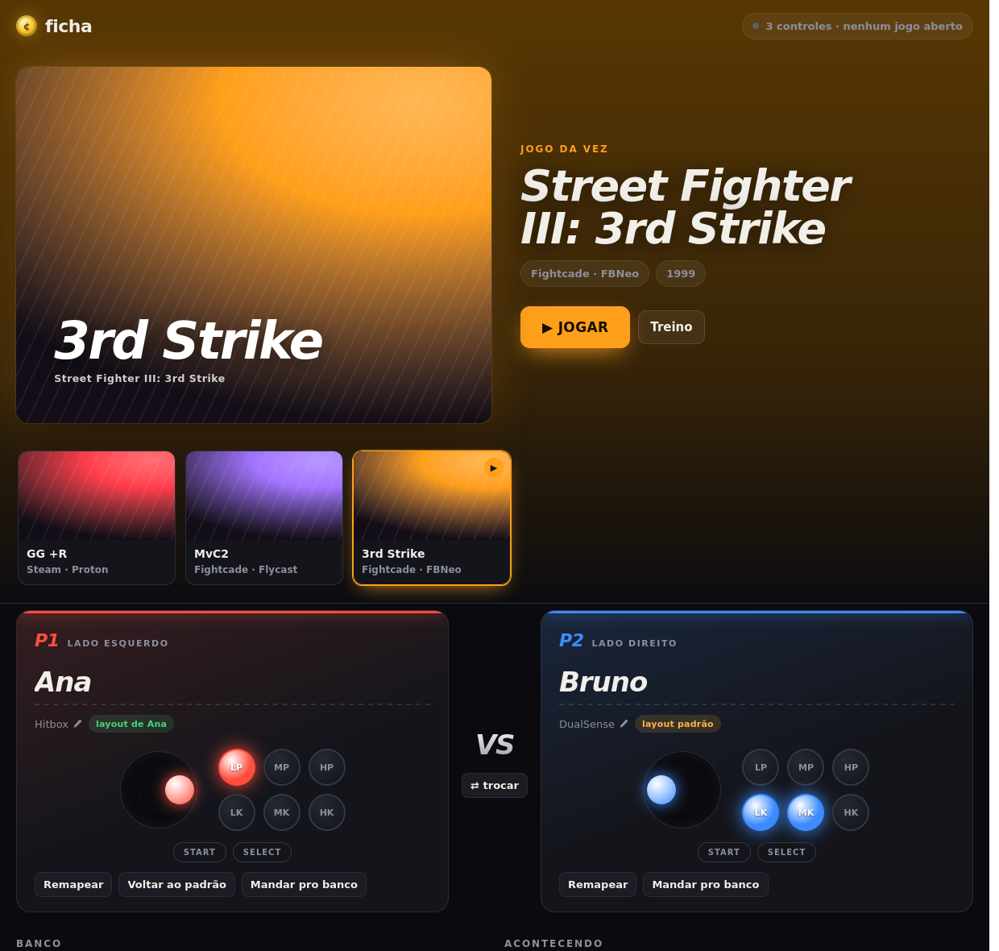

# ficha

**Controles plug-and-play pra jogatina presencial de jogo de luta.** Quem chega pluga o controle e joga: P1 e P2 são definidos sozinhos, cada pessoa mantém o próprio layout de botões, e ninguém precisa mexer no menu de controles do emulador.

[Read in English](README.md)



## Por quê

Emuladores e jogos de PC costumam identificar controle **pelo índice** (joystick 0, 1, 2…), e esse índice muda com a ordem em que as pessoas plugam. Numa jogatina, isso vira reconfigurar os controles toda vez que alguém troca de controle.

O ficha fica no meio. Ele lê os controles físicos e sai sempre pelos **mesmos dispositivos virtuais**: um teclado virtual com teclas fixas, ou dois controles virtuais, "ficha P1" e "ficha P2". A config do jogo é feita uma vez e nunca muda. Quem decide quem é P1 e quem é P2 é o ficha.

## O que ele faz

- **P1/P2 automático:** o primeiro controle plugado vira P1, o seguinte P2, e os outros esperam no banco e entram com START.
- **No próprio controle:** START+SELECT rapidinho troca de lado; segurar START+SELECT por 2 s remapeia os botões.
- **Layout padrão que faz sentido:** DualShock 4/DualSense, arcades compatíveis com PS4/PS5, controles Xbox e boxes com Raspberry Pi Pico (GP2040-CE em modo XInput) são mapeados por **posição física**, soco em cima e chute embaixo. Controles desconhecidos (placas DInput, encoders genéricos) ganham um mapeamento guiado de 8 toques.
- **Perfil por pessoa e por jogo:** escreva seu nome no painel e o seu layout vai junto pra qualquer controle. O layout é guardado por posição física, então um layout feito num controle Xbox funciona num DualSense.
- **Lembra de cada controle:** DS4/DualSense pelo MAC, controles USB pelo número de série e, se não tiver, pelo modelo. Dá pra dar apelido.
- **Painel web:** luzes dos botões ao vivo, prateleira de jogos, JOGAR / fechar jogo, abre no celular com `--lan`. Em português e inglês.
- **Jogos são arquivos TOML:** dá pra adicionar um jogo sem mexer em código (veja [docs/adding-a-game.pt-BR.md](docs/adding-a-game.pt-BR.md)).
- **Nenhuma dependência no Linux:** só a biblioteca padrão do Python.

## Jogos e backends

| Backend | Como o ficha fala com o jogo | Jogos que já vêm prontos |
|---|---|---|
| `fbneo-fightcade` | FBNeo (Fightcade) + teclado virtual; o ficha aponta o `.ini` do jogo pra teclas fixas | Street Fighter III: 3rd Strike |
| `flycast-fightcade` | Flycast (Fightcade) + controles virtuais; os outros controles ficam escondidos dele | Marvel vs. Capcom 2 (Dreamcast) |
| `steam` | Steam/Proton + controles virtuais; precisa de `ficha steam configurar <jogo>` uma vez | Guilty Gear XX Accent Core Plus R |
| `gamepad` | **qualquer** jogo ou emulador que lê controle (SDL, XInput, evdev), como o RetroArch | o seu TOML |
| `keyboard` | **qualquer** jogo configurável por teclado | o seu TOML |

O ficha **não inclui nem baixa jogos ou ROMs.** Use as suas cópias, obtidas legalmente.

## Instalação

### Linux (testado no Arch, GNOME/Wayland)

```bash
pipx install git+https://github.com/vagnertxr/ficha
```

O ficha precisa criar dispositivos virtuais pelo `/dev/uinput`. Muitas distros já liberam isso pro usuário logado (por exemplo, via o pacote `steam-devices`). Se o ficha disser que não tem acesso, instale a regra udev:

```bash
sudo cp contrib/60-ficha.rules /etc/udev/rules.d/ && sudo udevadm control --reload && sudo udevadm trigger
```

Detalhes em [docs/setup.pt-BR.md](docs/setup.pt-BR.md).

### Windows (experimental, sem teste)

A plataforma Windows está escrita, mas **ainda não foi testada num PC Windows de verdade**. Ela precisa do Python 3.11+, do driver [ViGEmBus](https://github.com/nefarius/ViGEmBus) e, pra esconder os controles físicos dos jogos, do [HidHide](https://github.com/nefarius/HidHide):

```bash
pip install "ficha[windows] @ git+https://github.com/vagnertxr/ficha"
```

Relatos e correções de quem usa Windows são muito bem-vindos.

## Uso

```bash
ficha                    # sobe o hub e abre o painel em http://localhost:7373
ficha jogar sfiii3nr1    # idem, e já abre o jogo
ficha jogos              # lista os jogos e se estão instalados
ficha steam configurar ggxxacpr --proton proton_9   # prepara um jogo da Steam (mostra as mudanças, pergunta antes)
ficha --lan              # painel também na rede local (celular)
ficha --lang pt          # força português (padrão: idioma do sistema)
```

Os comandos também têm nome em inglês (`play`, `games`, `steam setup`…).

## Documentação

- [Instalação e permissões](docs/setup.pt-BR.md)
- [Adicionando um jogo](docs/adding-a-game.pt-BR.md)
- [Controles e manias dos drivers](docs/controllers.pt-BR.md)
- [Como funciona](docs/architecture.pt-BR.md)
- [Problemas comuns](docs/troubleshooting.pt-BR.md)

## Situação

O ficha foi feito e testado em jogatina de verdade, no Linux:
- **Fightcade:** 3rd Strike (FBNeo) e MvC2 (Flycast), no Fightcade em flatpak;
- **Steam:** Guilty Gear XX AC+R, com Proton 9, na Steam em flatpak;
- **controles:** DualSense, uma placa Brook de PS4/PS5 e uma box com protocolo Xbox.

As instalações nativas (sem flatpak) de Fightcade e Steam e o Windows estão implementados, mas ainda sem teste.

## Licença

[MIT](LICENSE).
